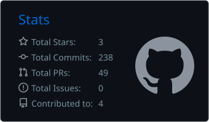
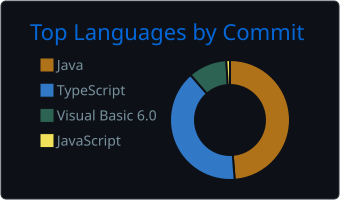

<h2>Olá, eu sou o Felipe !!! 👋</h2>

  Atualmente atuando como desenvolvedor Java com Spring Framework na construção de microsserviços voltados ao backend do setor financeiro e ambiente Cloud em projetos ágeis. Possuo sólida experiência como desenvolvedor frontend em React.js, consumindo APIs em backend Java. Possuo perfil automotivado e cooperativo, reconhecido pela flexibilidade e criatividade na solução de problemas.

  
  

<h3>Curiosidades:</h3>

- 🔭 Hoje trabalho como desenvolvedor fullstack (Angular e Java)
- 🌱 Cursando Ciências da Computação pelo Centro Universitário FEI
- 😄 Pronouns: Ele/Dele 🤣

  

 

<picture>
  <source media="(prefers-color-scheme: dark)" srcset="https://raw.githubusercontent.com/o-FM/o-FM/output/snake-dark.svg" />
  <source media="(prefers-color-scheme: light)" srcset="https://raw.githubusercontent.com/o-FM/o-FM/output/snake.svg" />
  
</picture>

<h3>Tecnologias:</h3>

  
  
  
  
  
  
  
  
  
  
  
  
  
  
  
  
  
  
  
  
  
  
  
  
  
  

